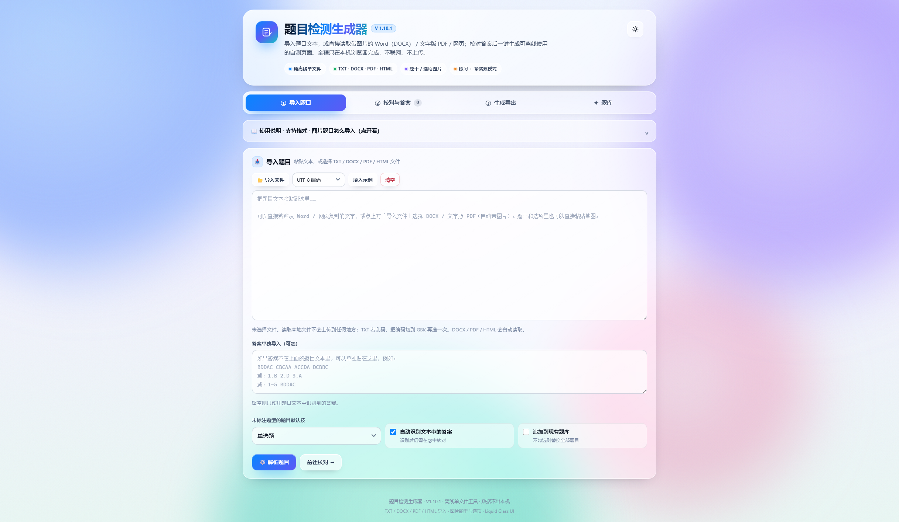

# 题目检测生成器 · QuizForge

> 把 Word / 文字版 PDF 题库变成**可离线分发的单文件自测网页**：不装软件、不上传、不依赖网络。

[](LICENSE)
[](#生成的文件)
[](#隐私与离线)
[](https://liurunzeeee-crypto.github.io/quizforge/)



**[▶ 打开在线预览](https://liurunzeeee-crypto.github.io/quizforge/)** · 不用下载，浏览器里直接试用

---

## 这是什么

很多老师、培训者和备考的同学手里都有 Word / PDF 题库，但要把它们变成“学生打开就能做题、还能判分”的页面，通常需要：

- 上传到某个在线考试平台；
- 注册账号、建题库、配题型；
- 或者手工把每道题做成网页/小程序。

这个工具把这件事压缩成四步：

1. 导入 Word、文字版 PDF 或文本；
2. 自动识别题目、选项、答案和图片；
3. 在浏览器里校对、补答案；
4. 生成一个**独立的单文件 HTML**，双击就能做题。

全程在浏览器本地完成，没有服务器、没有账号、没有上传。

---

## 适合谁

| 人群 / 场景 | 为什么适合 |
|---|---|
| 老师、培训讲师 | 把现成题库变成可发给学生的自测页，不需要学生装软件 |
| 学校机房、离线考试环境 | 单文件、双击即用、不联网，不受机房还原/断网影响 |
| 考研、自考、考证备考 | 把 PDF/Word 真题、题库快速变成可反复练习的页面 |
| 企业合规、安全培训 | 内部题目不便上传云端，单文件分发更可控 |
| 需要保护题目版权的人 | 生成的页面在自己手里，没有第三方平台托管 |

> 它不是一个“在线题库平台”。它解决的是**题目文件 → 可离线分发的自测页面**这一段。

---

## 功能

- **多种导入**：`.docx`、文字版 `.pdf`、`.html`、`.txt` / `.md`，也支持直接粘贴文本。
- **图片题自动提取**：
  - Word 里的图片按原位置变成 `[图1]`、`[图2]`；
  - 文字版 PDF 的内嵌图片按页面位置插回题干 / 选项；
  - HTML 里的内嵌 `data:image` 图片也可以提取。
- **手工补图**：题干、选项、解析都支持粘贴截图、拖拽图片、选择本地图片。
- **题型支持**：单选、多选、判断；自动识别章节标题和答案。
- **答案录入**：逐题点选、批量粘贴（`1-5 BDDAC`、`1.B 2.D`、纯字母串）。
- **单文件生成**：图片以 data URL 内嵌；生成的 HTML 不依赖 CDN、字体、外部图片。
- **两种作答模式**：练习模式（点选即判分）+ 考试模式（统一交卷、及格线）。
- **现代化界面**：磨砂玻璃 / 极光背景 / 深浅色 / 五套主题 / 移动端适配。
- **本地草稿**：自动保存到浏览器 localStorage，可导出题库 JSON。
- **隐私**：不联网、不上传；PDF.js 也完整内嵌在 HTML 里。

---

## 快速开始

### 方式一：在线预览（最快）

直接打开 **[https://liurunzeeee-crypto.github.io/quizforge/](https://liurunzeeee-crypto.github.io/quizforge/)**。

- 不需要下载、不需要安装；
- 页面从 GitHub Pages 加载，但题目仍然只在你浏览器里解析，不会上传；
- 想离线使用、发给学生，再用下面的方式二。

### 方式二：下载单文件（离线使用）

1. 打开 [dist/题目检测生成器.html](dist/题目检测生成器.html)；
2. 在文件页点 **Download raw**（或右键「链接另存为」）下载这个 HTML；
3. 双击用 Chrome / Edge 打开；
4. 按页面提示导入题目。

> 正式版本建议从 **Releases** 下载（后续会附在 Release 附件里）。  
> 生成的自测页面也是单个 HTML，可以直接发给学生，或者拷到 U 盘 / 机房电脑。

### 第一次用

1. ① 页面点「导入文件」，选择 `.docx` 或**文字版** `.pdf`；
2. 等待解析完成，点「解析题目」；
3. 到②核对答案、图片和题型；
4. 到③填写标题、选择模式，点「生成并下载 HTML」。

详细步骤见页面内的「使用说明」。

---

## 支持的输入格式

| 格式 | 文字 | 图片 | 说明 |
|---|---|---|---|
| `.docx` | ✅ | ✅ | 推荐；正文、表格、内嵌图片都可以提取 |
| 文字版 `.pdf` | ✅ | ✅ | 内置 PDF.js；扫描版 PDF 不支持 OCR |
| `.html` | ✅ | ✅ | 只读取内嵌 `data:image` 图片；外链图片离线不可读 |
| `.txt` / `.md` | ✅ | ❌ | 支持 UTF-8 / GBK；图片需手动粘贴 |
| 扫描版 PDF / 纯图片 | ❌ | — | 没有文字层，需要先 OCR |
| `.doc`（老 Word） | — | — | 请先在 Word 里另存为 `.docx` |

### 图片题是怎么工作的

Word/PDF 里的图片会被转成 `[图1]`、`[图2]` 这样的标记，放在原来的题干或选项文字里。生成检测页面时，标记会被替换成压缩后的内嵌图片：

- 题干图片 → 显示在题干下方；
- 选项图片 → 显示在对应选项里；
- 点击图片可以放大；
- 图片会自动压缩到最长边约 1400px，避免草稿超出浏览器 storage 上限。

---

## 生成的文件

生成出来的检测页面：

- 是**单个 HTML 文件**；
- 图片、样式、脚本全部内嵌；
- 不引用 CDN、字体、外部图片；
- 双击即可离线打开；
- 支持练习 / 考试模式、乱序、进度保存、答题卡、打印 / 存 PDF。

> 本工具本身约 2.1MB（因为内嵌了 PDF.js 和中文 CMap）；生成出来的检测页面通常只有几十 KB，除非题目图片很多。

---

## 隐私与离线

- 没有后端服务，没有账号系统，没有埋点；
- 导入的题目、答案、图片只存在于浏览器内存 / localStorage；
- PDF.js、解析器、生成器全部内嵌，不发起网络请求；
- 生成的检测页面也不会回传成绩；
- 卸载 / 清理浏览器数据会删除本地草稿，重要题库请定期「导出题库 JSON」。

注意：如果你把本项目部署到 GitHub Pages，**页面本身**是从网络加载的，但题目内容仍然只在你浏览器里处理，不会上传到服务器。

---

## 已知限制

- **扫描版 PDF / 纯图片试卷不做 OCR**：会提示先用 OCR 工具识别文字，或把题目截图逐题贴进选项。
- **PDF 特殊字体映射**：少数 PDF 使用了未内置的 CMap，文字可能提取失败；建议用 Word 打开 PDF 另存为 DOCX 再导入。
- **PDF 复杂版式**：双栏、旋转页面、跨页表格、矢量图可能需要人工校对。
- **Word 自动编号**：题号 / 选项字母如果是 Word 自动编号，浏览器无法还原；建议在 Word 里转为普通文本。
- **EMF / WMF**：Word 里的矢量图浏览器无法显示，会被跳过并提示。
- **浏览器差异**：优先 Chrome / Edge；Safari / Firefox 基本可用，但文件保存、剪贴板行为可能略有差异。
- **不做云同步**：没有账号、没有跨设备进度；需要备份请导出 JSON。
- **不附带题库**：仓库里的示例只用于演示导入 / 生成格式，不代表项目方题库；请自行确认示例内容的版权。

---

## 从源码构建

需要 Node.js 20+；**不需要 `npm install`**，项目没有 npm 依赖，PDF.js 已放在 `vendor/pdfjs/`。

```bash
npm run build          # 生成 dist/题目检测生成器.html
npm test               # 解析器 + 解压单元测试
npm run test:e2e       # 可选：真实 Chrome 端到端测试（Windows 路径需改）
npm run validate       # 可选：Python + lxml 检查构建产物
```

构建过程：

1. `src/index.html` + `src/builder.css` → Builder 外壳；
2. `src/app-*.js` → Builder 运行时；
3. `src/quiz.html` + `src/quiz.css` + `src/quiz.js` → 生成页面模板；
4. `vendor/pdfjs/*` → 内嵌 PDF.js + worker + 中文 CMap；
5. 全部装进 `dist/题目检测生成器.html`。

---

## 项目结构

```text
.
├─ src/                     # Builder 源码
│  ├─ index.html            # 外壳
│  ├─ builder.css           # Liquid Glass UI
│  ├─ app-core.js           # 状态 / 题库模型 / 解析器 / 草稿
│  ├─ app-import.js         # DOCX / HTML / 图片导入
│  ├─ app-pdf.js            # 文字版 PDF 导入（PDF.js）
│  ├─ app-ui.js             # 界面 / 交互 / 生成
│  ├─ quiz.html             # 生成页面模板
│  ├─ quiz.css
│  └─ quiz.js
├─ scripts/build.mjs        # 单文件构建脚本
├─ tests/                   # 单元测试 / E2E / 校验
├─ vendor/pdfjs/            # PDF.js 3.11.174（Apache-2.0）
├─ dist/                    # 构建产物（单文件 HTML）
├─ docs/screenshots/        # README 截图
├─ examples/                # 自编示例题库
├─ LICENSE                  # MIT（本项目代码）
├─ NOTICE                   # PDF.js 等第三方声明
└─ .github/                 # Issue 模板 / CI / Pages
```

---

## 路线图

- [x] V1.10：选项解析修复、Word/HTML 图片、Liquid Glass UI、单文件构建
- [x] V1.10：文字版 PDF 自动提取文字 + 图片
- [ ] 错题本导出 / 导入、成绩记录
- [ ] Anki / CSV 导出
- [ ] 更多题库模板与批量编辑
- [ ] 移动端体验优化
- [ ] 可选 OCR（独立模块，不塞进主文件）

---

## 贡献

欢迎提 Issue / PR，尤其是：

- 解析失败的题库格式（请提供**删改后的最小复现文本**，不要上传版权题库）；
- 新的题库排版样例；
- 浏览器兼容性问题；
- 文档、翻译、截图。

提交 PR 前请先运行 `npm test` 和 `npm run build`。详见 [CONTRIBUTING.md](CONTRIBUTING.md)。

**请勿**在 Issue / PR 中上传教材、真题、培训机构题库或含个人信息的文件。

---

## 许可证与第三方

- 本项目源码：**MIT License**，见 [LICENSE](LICENSE)。
- 第三方组件：
  - PDF.js 3.11.174，Apache-2.0；
  - PDF.js 附带的中文 CMap 数据，Apache-2.0。
  - 完整声明见 [NOTICE](NOTICE) 和 `vendor/pdfjs/LICENSE`。
- 用户导入的题目、答案、图片版权归原权利人所有；本项目不提供题库，也不对用户导入内容的版权负责。

---

## English

**QuizForge** is an offline, single-file quiz builder for Chinese exam-prep and classroom use.

Import a Word document or a text-based PDF, review answers and images, then export a fully self-contained HTML quiz. Images are extracted automatically and embedded as data URLs. No server, no upload, no CDN, no account. Scanned PDFs are not OCR'd.


